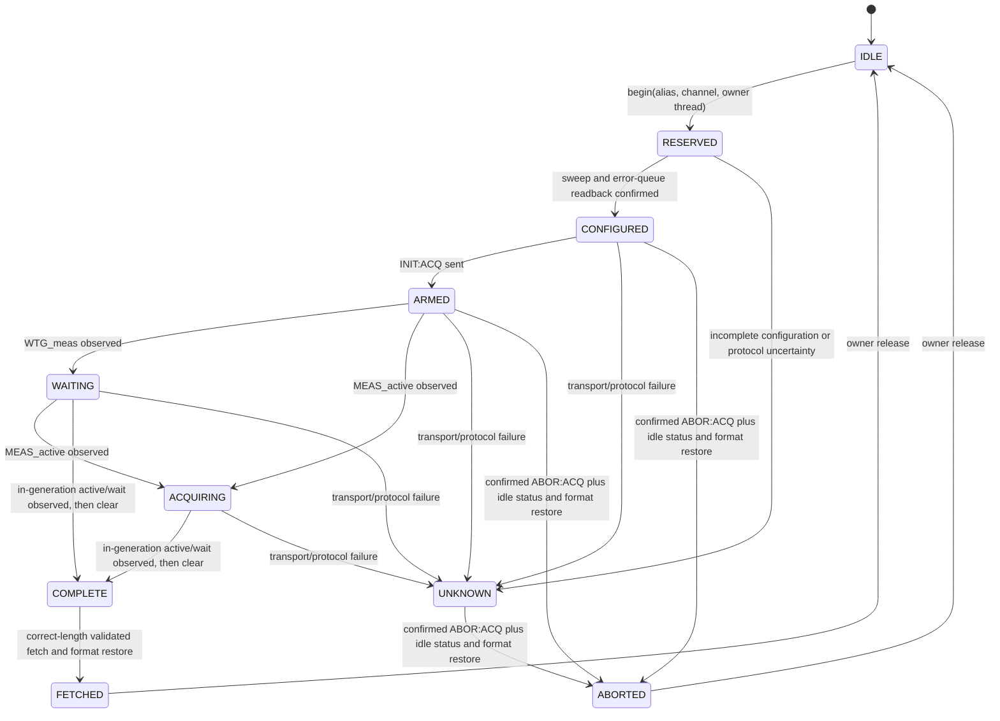
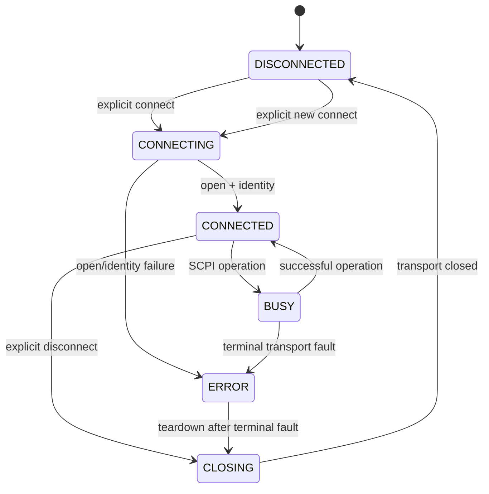

# DRV-14: acquisition lease and terminal transport recovery

## Baselines

- Driver: `2f4a8333f8fb8496ef29cec63a24be15a3c33886` (v0.7.10).
- SCPI core pin: `9c5dd50a03031f65e1aa5cf13832db7372f043b9`.
- This implementation is **offline only**. No electrical safe-OFF condition can be deduced from a transport error or a released host-side lease.

## Lease and acquisition state diagram

`RESERVED` is an **ownership layer** in `AcquisitionCoordinator`, not an enum member of `AcquisitionTracker`; the latter uses `IDLE, CONFIGURED, ARMED, WAITING, ACQUIRING, COMPLETE, FETCHED, ABORTED, UNKNOWN`. The acquisition generation increments on successful ARM and is only evidence about this driver instance, not a physical sample-time oracle.

Terminal transport failure has an additional host-side transition from *any reserved state*: `lease owner -> cleared`, `session state -> ERROR`. This **does not** transition the instrument to `ABORTED` or electrical OFF; the acquisition tracker may remain `UNKNOWN` until a new verified session. This distinction is intentional.

## Connection states, preconditions and lock hierarchy

An ERROR/faulted session cannot auto-replay normal SCPI commands. Fresh `connect` and instrument/readback validation are separate from releasing a resource lease. Reconnecting alone never confirms safe-OFF.

- Per-alias `entry.lock` serializes acquisition reservation with regular command I/O.
- `AcquisitionCoordinator._lock` guards the lightweight lease owner map only; do **not** hold it over core I/O or callbacks.
- `BaseInstrument._connect_session` acquires the registry lock, then the old alias lock, validates replace under both, and tears down that session while protected. A competing reservation on the old entry cannot slip between the replacement guard and teardown.
- `BaseInstrument._disconnect_session` attempts best-effort safe state **before** entering `CLOSING`; on terminal transport failure the attempt cannot prove OFF and must remain unverified.
- Different aliases are separate logical mainframes; multiple *independent process controllers* must negotiate an external physical-mainframe lock. Two aliases pointing at the same physical instrument are **not** safely isolated by the alias-scoped coordinator; the caller must never configure that topology concurrently.

## Verified recovery invariants

1. Transport terminal state `FAULTED` or `CLOSED` invalidates only that alias's bookkeeping.
2. No read-only query may be falsely served from a terminal session; a connection error precedes stale lease policy. Unreachable hardware cannot prove safe-OFF.
3. A healthy active owner is not invalidated by a different thread, channel, query, reconnect, or disconnect.
4. Explicit abort may release lease only after instrument idle readback and response-format restoration.
5. Failure during abort or data fetch never produces a validated waveform or verified output state.
6. No unsafe SCPI command is automatically resent as part of fault recovery.
7. Both physical and simulator transports must independently enforce bounded I/O timeouts; this module does not make an indefinitely blocking third-party backend interruptible.
8. Emergency shutdown is not rejected solely because an unrelated digitizer lease exists, but may still be delayed by the serialization needed for an in-flight command. No strict real-time electrical shutdown deadline can be guaranteed over a failed transport.

## Offline test coverage

`tests/unit/test_terminal_transport_acquisition_recovery.py` covers simulated faulted readback, status timeout, abort timeout, idempotent teardown, two logical aliases, healthy lease contention, replacement and safe-state command ordering.

## Release gates and residual risks

- A genuinely separate independent concurrency/safety review is mandatory before merge.
- No hardware capture or electrical verification was performed; hardware N679-04/N679-05 qualification remains outstanding.
- No cross-process/alias-alias same-mainframe arbitration is implemented.
- The transport fault may leave hardware outputs ON. A physically safe state must be **independently measured/confirmed** after a new trusted session.
